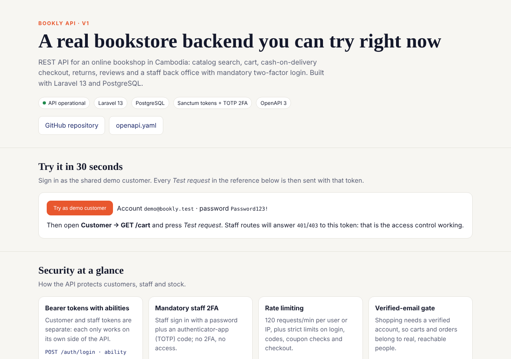
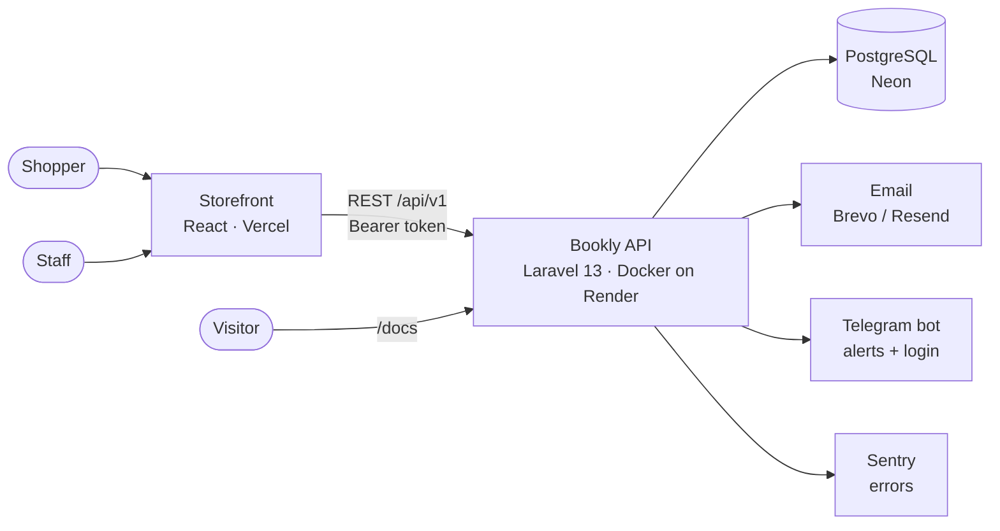
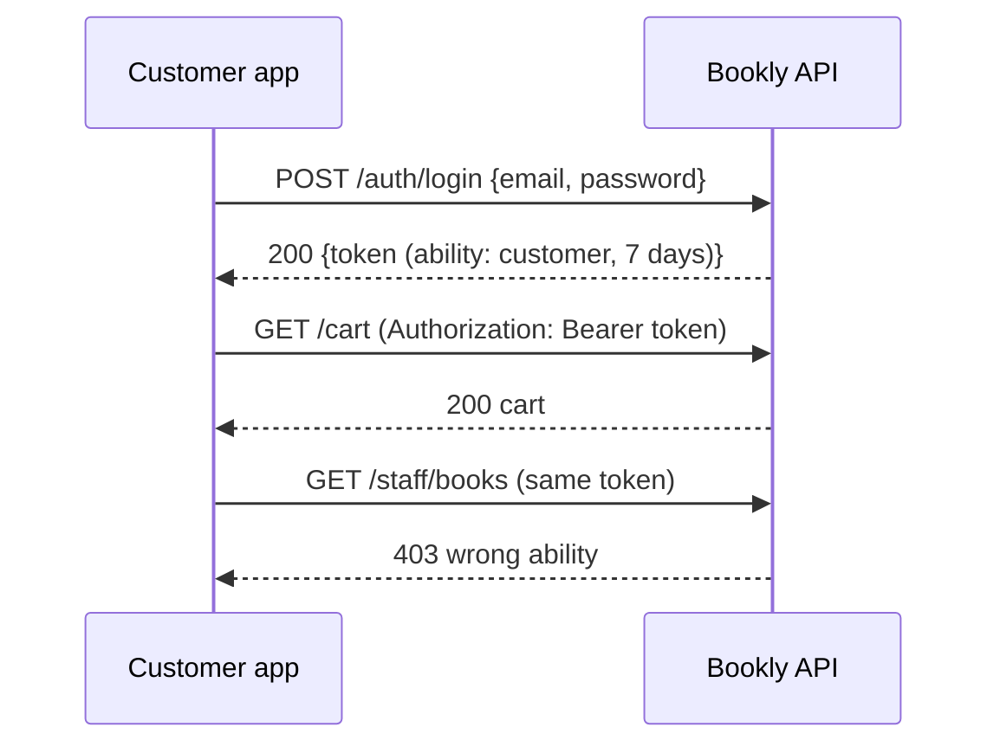
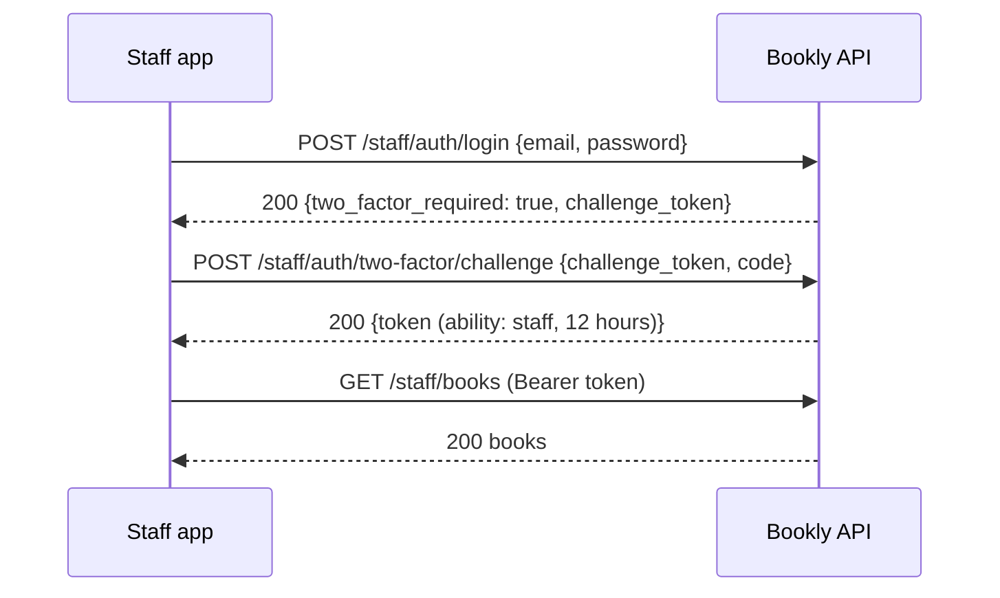

<div align="center">

# 📚 Bookly API

**The backend of a real online bookstore in Cambodia: catalog search, cart, checkout, returns, reviews and a staff back office with mandatory two-factor login.**

[](https://github.com/danishsary8/bookly_backend_v2/actions/workflows/tests.yml)


### [▶ Try the live API](https://bookly-api-zasc.onrender.com/docs) · [🛒 Live storefront](https://bookly-frontend-five.vercel.app) · [💻 Frontend repo](https://github.com/danishsary8/bookly_frontend)

</div>

[](https://bookly-api-zasc.onrender.com/docs)

> **Try it in 30 seconds:** open the [live docs](https://bookly-api-zasc.onrender.com/docs), click **Try as demo customer**, then send a real request to `GET /cart`. The shared demo account is protected (its sign-in details can't be changed) and tidied every hour. The API runs on a free plan, so the first request after a quiet spell can take ~50 s to wake it up.

## Highlights

- 🔐 **Two kinds of tokens, two-factor staff login.** Customer and staff tokens carry different abilities, so neither can reach the other's routes; staff must pass an authenticator-app (TOTP) code.
- 🧾 **Checkout that can't double-charge.** An `Idempotency-Key` makes retries safe, and row locks in a fixed order mean two people buying the last copy get one order and one clear "out of stock".
- 🛒 **A cart that never silently changes.** Prices, stock and availability are re-checked on every read; a changed line carries an `issues` entry instead of a surprise at checkout.
- 🔎 **PostgreSQL full-text search** across titles, descriptions, authors, series and categories, with filters and sorting.
- 💵 **USD and Cambodian riel** side by side, converted from the exchange rate in force when the order was placed.
- 📣 **Operations built in:** Telegram and email order alerts, JSON logs with request IDs, Sentry, health checks and self-running housekeeping jobs.

## Architecture



Inside the API, routes go through middleware (token abilities, verified email, staff 2FA, rate limits) to thin controllers. Business rules live in small services (`CartService`, `CheckoutService`, `InventoryService`, `OrderStatusService`, …) so checkout, returns and the back office share one set of rules.

## Security

**Customer login** — a token that only works on customer routes:



**Staff login** — no access without the authenticator-app code:



More protections: email codes are stored hashed, single-use and die after 5 wrong guesses; TOTP codes cannot be replayed; login, code, coupon and checkout endpoints are rate-limited per email and per IP; every error is JSON with an `X-Request-Id`; security headers on every response. Full limits: [docs/RATE_LIMITS.md](docs/RATE_LIMITS.md).

## Tech choices

| Choice | Why | Trade-off |
| --- | --- | --- |
| Laravel 13 + Sanctum tokens | Mature framework; token abilities give a clean customer/staff split for a separate React app | No cookies/sessions, so the frontend stores the token itself |
| PostgreSQL full-text search | One database, no extra search service to run or pay for | Less typo-tolerant than a dedicated engine like Meilisearch |
| Idempotency keys on checkout | A double click or network retry can't create two orders | Clients must send a fresh key per order |
| Money in integer cents | No floating-point rounding errors in totals and discounts | Conversions at the edges (stored as `DECIMAL(10,2)`) |
| Housekeeping run from API traffic | Works on hosts with no scheduler (Render free); same jobs run on a real scheduler elsewhere | Jobs only run while the API receives requests |
| Render + Neon free tier | Real public deployment at no cost | Cold starts after idle time; monthly database compute limit |
| OpenAPI spec as the source of truth | The docs page, the frontend's TypeScript types and a test that every route is documented all come from one file | The spec must be updated with every route (the test enforces it) |

## Design decisions worth noting

- **Formats as variants.** A book has shared details; each format (paperback, hardcover, ebook, audiobook) is a `book_variants` row with its own price, stock and SKU.
- **History is never lost.** Orders keep a copy of the shipping address and the price paid; ordered formats can be deactivated but not deleted; books are soft-deleted.
- **Stock has one entry point.** Every change goes through `InventoryService`, which locks the row and writes an `inventory_movements` entry.
- **Database-level rules.** CHECK constraints for statuses, formats, ratings and prices; unique constraints such as one format per book.
- **Performance.** The book list loads in a fixed number of queries regardless of page size (covered by a test).

### Data model

35 domain tables in third normal form (42 including Laravel's own cache, queue and token tables):

| Domain | Tables |
| --- | --- |
| Accounts | customers, staff_users, customer_addresses, verification_tokens, staff_login_histories |
| CRM | customer_tags, customer_customer_tag, customer_notes |
| Catalog | books, book_variants, authors, publishers, categories, series, book_authors, book_categories |
| Inventory | inventory_movements, stock_alerts |
| Cart | carts, cart_items, wishlists |
| Promotions | coupons, newsletter_subscribers, newsletter_campaigns, marketing_outbox |
| Orders | orders, order_items, order_status_history |
| Payments | payments, payment_webhook_logs |
| Returns | returns, return_items |
| Reviews | reviews |
| Admin | exchange_rates, admin_audit_logs |

## Features

**Customers:** sign up with email (6-digit code) or Google/Facebook · full-text search with filters and sorting · USD and KHR prices · saved addresses · wishlist with reading status · cart with stock checks · coupons · cash-on-delivery checkout · order history, cancel while pending, **buy again** · returns for physical formats within a configurable window (7 days by default) · verified-purchase reviews.

**Staff and admins:** mandatory TOTP 2FA · manage books, formats, authors, categories, publishers and series (CSV import/export) · stock adjustments with history · orders, returns and refunds · coupons · review moderation · customers · dashboard and reports · exchange rates · staff accounts · audit log.

## Run it locally

Requirements: PHP 8.4+, Composer, PostgreSQL 14+.

```bash
git clone https://github.com/danishsary8/bookly_backend_v2.git && cd bookly_backend_v2
composer install && cp .env.example .env && php artisan key:generate
php artisan migrate
php artisan db:seed --class=DemoSeeder   # 20 books, 5 customers, a month of orders
php artisan serve                        # docs at http://localhost:8000/docs
```

Set the `DB_*` values in `.env` first (database `bookshop_v2`, plus `bookshop_v2_test` for the tests). Demo logins: `demo@bookly.test`, `admin@bookly.test`, `staff@bookly.test`, password `Password123!` (staff set up 2FA at first login). Optional settings (email, social login, Sentry, CORS) are listed in `.env.example`.

## Tests

```bash
php artisan test            # 591 tests against PostgreSQL
vendor/bin/pint --test      # code style
```

CI runs both on every push and pull request; deploys wait for green CI. The suite includes a test that every route is documented in the OpenAPI spec, query-count checks on the book list, and checks that every housekeeping job is a real command.

## Deployment

One Docker image (FrankenPHP) runs as web server, queue worker or scheduler (`CONTAINER_ROLE`). Two ready paths: free (Render + Neon) or Railway with infrastructure as code. Step by step: [docs/DEPLOYMENT.md](docs/DEPLOYMENT.md).

```bash
docker build -t bookly-api .
docker run --rm -p 8080:8080 --env-file .env bookly-api   # http://localhost:8080/docs
```

## Documentation

- [Live API reference](https://bookly-api-zasc.onrender.com/docs) and the raw [OpenAPI spec](public/openapi.yaml)
- [docs/API.md](docs/API.md): field-by-field endpoint reference
- [docs/DEPLOYMENT.md](docs/DEPLOYMENT.md): deploy, operate and back up
- [docs/RATE_LIMITS.md](docs/RATE_LIMITS.md): every limit and why
- [docs/WORKLOG.md](docs/WORKLOG.md): step-by-step build log and decisions

**Next on the roadmap:** card and Bakong KHQR payments (the `payments` and `payment_webhook_logs` tables are ready).

## Author

Built by [@danishsary8](https://github.com/danishsary8) — API design, database, security and deployment.
