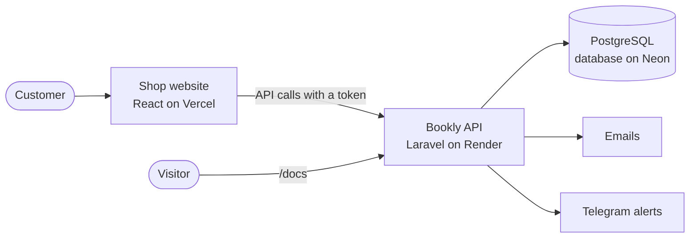
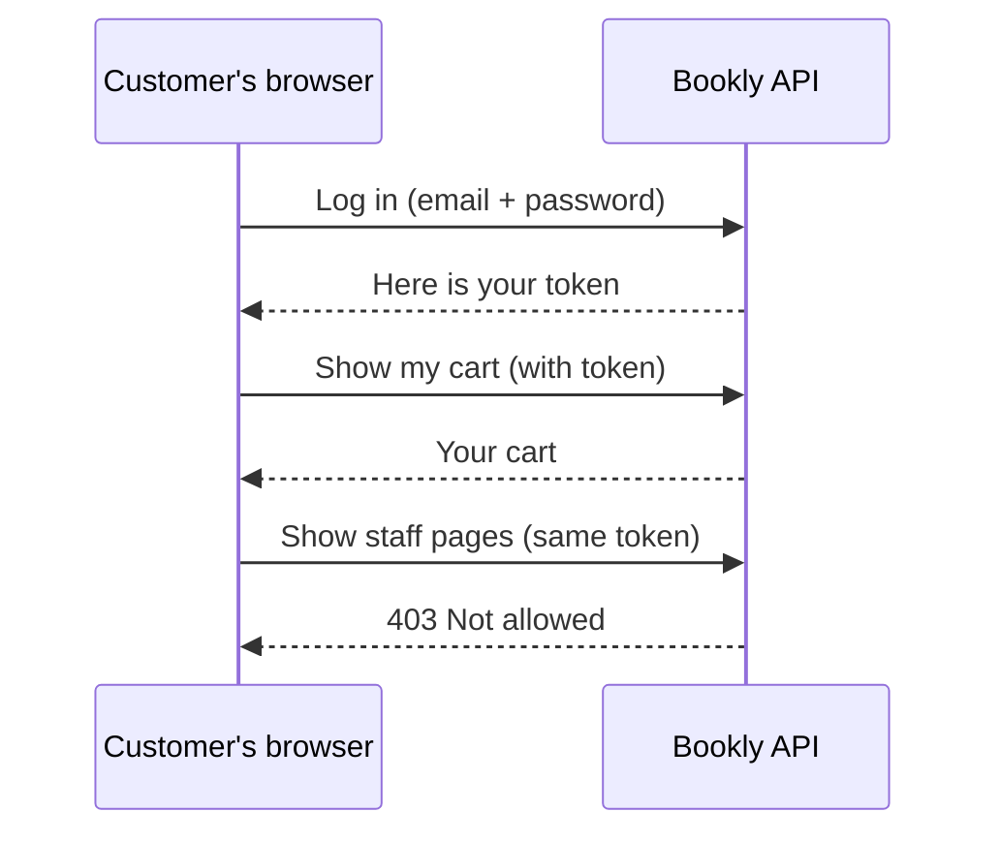

<div align="center">

# 📚 Bookly API

**The backend for a real online bookshop in Cambodia.**
Customers can search books, fill a cart, check out and return items. Staff run the shop from a back office.

[](https://github.com/danishsary8/bookly_backend_v2/actions/workflows/tests.yml)


### [▶ Try the live API](https://bookly-api-zasc.onrender.com/docs) · [🛒 See the shop](https://bookly-frontend-five.vercel.app) · [💻 Frontend code](https://github.com/danishsary8/bookly_frontend)

</div>

[](https://bookly-api-zasc.onrender.com/docs)

## Try it yourself (1 minute)

1. Open the **[live API docs](https://bookly-api-zasc.onrender.com/docs)**. The first visit can take up to a minute while the free server wakes up.
2. Click **Sign in as demo customer**. No password needed.
3. Open **Customer → GET /cart**, press **Try it out**, then **Execute**. You get a real answer from the live server.
4. Now try a staff endpoint, like **GET /staff/books**. You get **403 Forbidden**: a customer can never use staff features.

## What it does

**For customers**
- Sign up with email (a 6-digit code confirms it) or with Google / Facebook
- Search and filter books; see prices in US dollars and Cambodian riel
- Wishlist, cart, coupons and cash-on-delivery checkout
- Order history, cancel an order while it is still pending, and **buy again** in one click
- Return books after delivery, and review books they bought

**For staff**
- Sign in with a password **plus** a code from an authenticator app (two-factor login)
- Manage books, authors, categories, stock, orders, returns, coupons and reviews
- Dashboard, reports, CSV import/export and an audit log of every change

## How it keeps things safe

| Problem | How Bookly solves it |
| --- | --- |
| Someone steals a customer's login | Customer and staff use **different tokens**. A customer token can never open staff pages. |
| Someone guesses a staff password | Staff also need a **one-time code** from an authenticator app. |
| Bots try thousands of passwords | **Rate limits** slow down sign-in, codes, coupons and checkout. |
| A customer clicks "Order" twice | Each order has a unique **idempotency key**, so the second click can't create a second order. |
| Two people buy the last copy at once | Stock is **locked** during checkout, so only one order succeeds; the other gets "out of stock". |
| A price changes after adding to cart | The cart **shows a warning** on that line instead of quietly changing the total. |

Everything about the public demo is locked down too: the demo account can't change its password or email, it is cleaned every hour, and the demo sign-in button is limited to 10 uses per hour per visitor.

## How it is built



**In simple words:**
- The **shop website** (a separate project) talks to this API over the internet.
- The **API** checks who you are, applies the shop's rules (stock, prices, coupons) and saves everything in the **database**.
- The shop owner gets **Telegram and email alerts** for new orders and low stock.

### Signing in, step by step



Staff do the same, plus one extra step: after the password, they enter the 6-digit code from their authenticator app before they get a token.

## Why I chose these tools

| Choice | Why | The trade-off |
| --- | --- | --- |
| **Laravel + Sanctum** | Fast to build with; tokens make it easy to keep customers and staff apart | The website has to store the token itself |
| **PostgreSQL search** | Good search without paying for or running a separate search service | Less forgiving of typos than a dedicated search engine |
| **Prices in cents** | Whole numbers never have rounding errors | Convert to dollars only when showing them |
| **OpenAPI spec as the single source** | The docs page, the website's TypeScript types and a test that checks every route is documented all come from one file | Every new route must be added to the spec (a test makes sure) |
| **Free hosting (Render + Neon)** | A real, public deployment that costs nothing | The server sleeps when idle, so the first request is slow |

## The database

35 tables, grouped by what they store:

| Area | Tables |
| --- | --- |
| Accounts | customers, staff_users, customer_addresses, verification_tokens, staff_login_histories |
| Customer notes | customer_tags, customer_customer_tag, customer_notes |
| Books | books, book_variants (each format: paperback, ebook…), authors, publishers, categories, series, book_authors, book_categories |
| Stock | inventory_movements, stock_alerts |
| Shopping | carts, cart_items, wishlists |
| Promotions | coupons, newsletter_subscribers, newsletter_campaigns, marketing_outbox |
| Orders | orders, order_items, order_status_history |
| Payments | payments, payment_webhook_logs |
| Returns | returns, return_items |
| Reviews | reviews |
| Admin | exchange_rates, admin_audit_logs |

A few rules that keep the data trustworthy:
- **Orders keep a copy** of the address and the price paid, so old orders never change.
- **Every stock change is logged**, so you can always see why a number went up or down.
- **The database itself checks** prices, ratings and statuses, so bad data can't get in even by mistake.

## Run it on your computer

You need: PHP 8.4, Composer and PostgreSQL.

```bash
git clone https://github.com/danishsary8/bookly_backend_v2.git
cd bookly_backend_v2
composer install
cp .env.example .env            # then set the DB_* lines to your database
php artisan key:generate
php artisan migrate
php artisan db:seed --class=DemoSeeder   # 20 books, 5 customers, sample orders
php artisan serve                        # open http://localhost:8000/docs
```

Demo accounts: `demo@bookly.test` (customer), `admin@bookly.test` and `staff@bookly.test` (staff). Password for all: `Password123!`. Staff set up two-factor login the first time they sign in.

## Tests

```bash
php artisan test            # 599 tests
vendor/bin/pint --test      # code style
```

Every push and pull request runs these automatically on GitHub.

## Deploy

The API ships as one Docker image. Step-by-step guide (free hosting or Railway): [docs/DEPLOYMENT.md](docs/DEPLOYMENT.md).

## More docs

- [Live API docs](https://bookly-api-zasc.onrender.com/docs) and the [OpenAPI file](public/openapi.yaml)
- [docs/API.md](docs/API.md): every endpoint, field by field
- [docs/RATE_LIMITS.md](docs/RATE_LIMITS.md): every limit and why
- [docs/WORKLOG.md](docs/WORKLOG.md): how the project was built, step by step

**Next up:** card and Bakong KHQR payments (the database tables are already in place).

---

Built by [@danishsary8](https://github.com/danishsary8).
