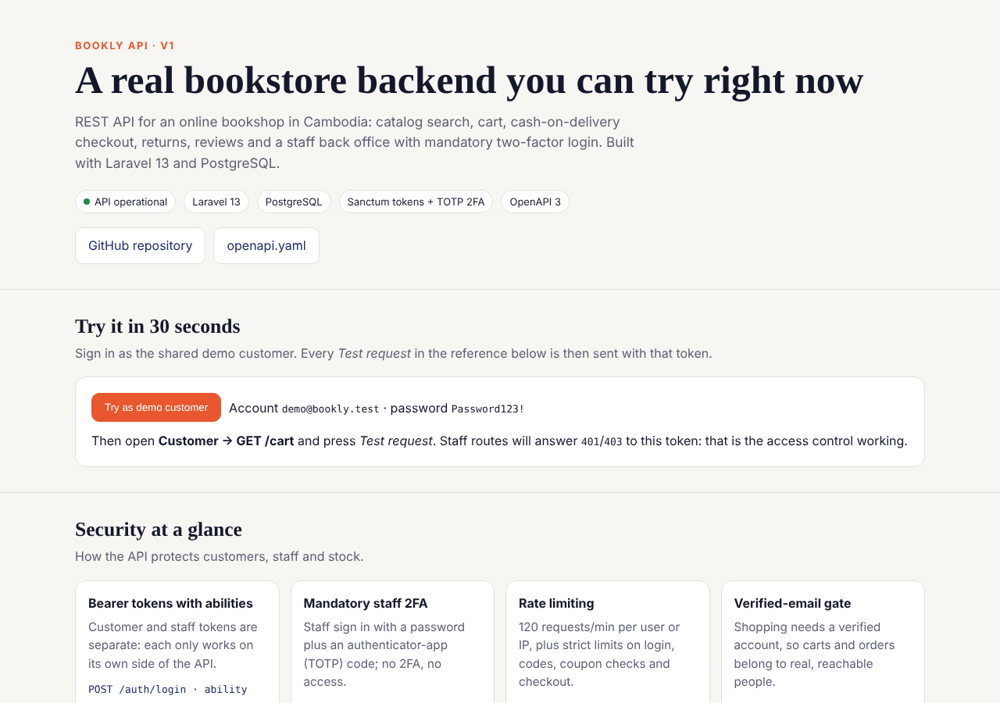
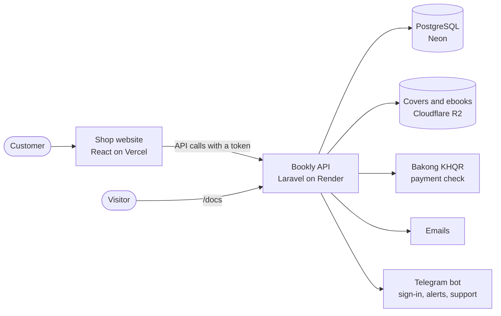
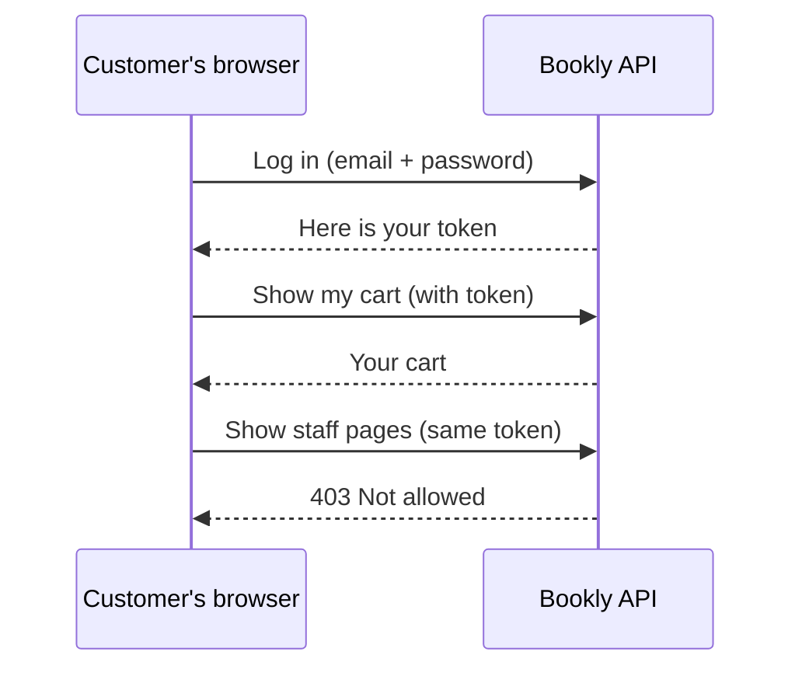

<div align="center">

# 📚 Bookly API

**The backend for a real online bookshop in Cambodia.**
Customers search books, fill a cart, pay with cash on delivery or a Bakong KHQR code, read ebooks and return items.
Staff run the shop from a back office. English and Khmer, US dollars and riel.

[](https://github.com/danishsary8/bookly_backend_v2/actions/workflows/tests.yml)


### [▶ Try the live API](https://bookly-api-zasc.onrender.com/docs) · [🛒 See the shop](https://bookly-frontend-five.vercel.app) · [💻 Frontend code](https://github.com/danishsary8/bookly_frontend)

</div>

[](https://bookly-api-zasc.onrender.com/docs)

## At a glance

| | |
| --- | --- |
| **What** | A REST API (`/api/v1`) for a complete bookshop: catalogue, cart, checkout, payments, ebooks, support and back office |
| **Size** | 316 endpoints, 65 tables, 104 migrations, 1,058 automated tests |
| **Stack** | Laravel 13 (PHP 8.4), PostgreSQL 16, Sanctum tokens, Docker |
| **Hosting** | Render (API), Neon (database), Cloudflare R2 (covers and private ebook files) |
| **Frontend** | [Bookly shop website](https://github.com/danishsary8/bookly_frontend): React 19 + TypeScript |

## Try it yourself (1 minute)

1. Open the **[live API docs](https://bookly-api-zasc.onrender.com/docs)**. The first visit can take up to a minute while the free server wakes up.
2. Click **Sign in as demo customer**. No password needed.
3. Open **Customer → GET /cart**, press **Try it out**, then **Execute**. You get a real answer from the live server.
4. Now try a staff endpoint, like **GET /staff/books**. You get **403 Forbidden**: a customer can never use staff features.

## What it does

### For customers
- **Sign up and sign in** with email (a 6-digit code confirms it), Google, Facebook or **Telegram**, or with a code the
  Telegram bot sends to a confirmed phone number. Passwords are checked against known data leaks (Have I Been Pwned).
- **Search** that forgives typos (`holms` finds Holmes) and works in Khmer, a category tree, filters for reader age,
  school grade and English level, and prices in US dollars or Cambodian riel.
- Optional **search by meaning** and **similar books** (PostgreSQL pgvector + Gemini embeddings); off by default, and
  any error falls back to normal search.
- "You may also like", the rest of a series, more by the same author, best sellers, new arrivals, coming soon, ebook deals.
- Wishlist with price-drop alerts, back-in-stock alerts, cart with coupons and **offers**: percent or amount off,
  "any N books for $P" **bundles**, set offers and **free gifts**; free delivery above a set amount; cart reminder emails.
- **Checkout** with **cash on delivery or Bakong KHQR** (a real KHQR code, 15 minutes to pay, checked with Bakong),
  pre-orders and back-orders, and an optional map pin for the address.
- **Ebooks** read in the browser: the API never sends the file, only page images with the reader's email and order
  number burned in; reading progress, up to 3 devices, and a free preview without an account.
- Order history, cancel while pending, **buy again** in one click (even when only part is in stock), returns with
  refunds or store credit, reviews of books they bought, order ratings, reward coupons, order updates in Telegram.
- **Support chat** with staff (guests get replies by email), and a **helper bot** that answers common questions,
  finds books and explains your own orders. The bot is rules-based and runs inside the API: no outside AI service.
- Active sessions with device sign-out, new-device security alerts, download my data, close my account.

### For staff
- Sign in with a password **plus** a code from an authenticator app (two-factor login), with **per-permission access**
  (catalogue, orders, customers, reviews, support, reports, members, settings). Admin and staff portals are separate.
- Manage books (covers on Cloudflare R2, ebook PDF upload), authors, categories with menu order and icons, series,
  publishers, suppliers, stock with restock costs, and CSV import/export (including a guide for Khmer books).
- **Bulk price change** across up to 3,000 formats (set, percent, amount or markup on cost, with rounding), a preview
  before saving, a floor so nothing sells below cost, and **undo**.
- Orders, returns and refunds, reviews, customers (tags and notes), coupons, offers, promotions, collections,
  reading lists, reward rules, newsletters, the support inbox and the helper bot's knowledge base.
- Mark KHQR orders as paid by hand when needed (with a note in the order history).
- **Dashboard and reports**: sales, orders, inventory, customers, offers and a **profit report**, a monthly sales goal,
  CSV and one-click Excel export, notifications, a system health check and an **audit log** of every change.
- Staff alerts for new orders, low stock and support messages by **Telegram and email**; staff can reply to support
  chats straight from Telegram.

## How it keeps things safe

| Problem | How Bookly solves it |
| --- | --- |
| Someone steals a customer's login | Customer and staff use **different tokens**. A customer token can never open staff pages. |
| Someone guesses a staff password | Staff also need a **one-time code** from an authenticator app. |
| A staff member sees more than their job needs | Every staff route checks a **permission**, and admin-only actions (prices, coupons, settings) are **audited**. |
| Bots try thousands of passwords | **Rate limits** slow down sign-in, codes, coupons, search and checkout ([docs/RATE_LIMITS.md](docs/RATE_LIMITS.md)). |
| A customer clicks "Order" twice | Each order has a unique **idempotency key**, so the second click can't create a second order. |
| Two people buy the last copy at once | Stock, coupons and offers are **row-locked** during checkout, so only one order gets the last copy or use. |
| A price changes after adding to cart | The cart **shows a warning** on that line instead of quietly changing the total. |
| Someone fakes a "payment done" message | The browser never says an order is paid. The **API asks Bakong** itself and only then marks it paid. |
| A customer pays after the 15 minutes ran out | The order is already cancelled, so the API **alerts staff** to refund instead of silently taking the money. |
| Someone shares a bought ebook | Pages are images with the buyer's details burned in, limited to 3 devices; the PDF is never sent. |

The public demo is locked down too: the demo account can't change its password or email, write public reviews or connect
Telegram; it is cleaned every hour, and the demo sign-in button is limited to 10 uses per hour per visitor.

## How it is built



**In simple words:**
- The **shop website** (a separate project) talks to this API over the internet.
- The **API** checks who you are, applies the shop's rules (stock, prices, coupons, offers) and saves everything in the **database**.
- For KHQR payments the API builds the QR code itself and **asks Bakong** whether it was paid.
- The shop owner gets **Telegram and email alerts**; customers can get order updates in Telegram too.
- Background work (emails, ebook page rendering, reminders, clean-up) runs on Laravel's queue and a maintenance runner,
  so the free hosting plan needs no separate scheduler.

### Signing in, step by step



Staff do the same, plus one extra step: after the password, they enter the 6-digit code from their authenticator app before they get a token.

## Why I chose these tools

| Choice | Why | The trade-off |
| --- | --- | --- |
| **Laravel + Sanctum** | Fast to build with; tokens make it easy to keep customers and staff apart | The website has to store the token itself |
| **PostgreSQL search** (trigram + optional pgvector) | Good, typo-tolerant search without running a separate search service | Less tunable than a dedicated search engine |
| **Prices in cents** | Whole numbers never have rounding errors | Convert to dollars only when showing them |
| **OpenAPI spec as the single source** | The docs page, the website's TypeScript types and a test that checks every route is documented all come from one file | Every new route must be added to the spec (a test makes sure) |
| **Rules-based helper bot** | Free, private and predictable; no customer data leaves the server | It only knows what its rules and FAQ list cover |
| **Free hosting (Render + Neon)** | A real, public deployment that costs nothing | The server sleeps when idle, so the first request is slow |

## The database

65 tables (plus Laravel's own cache, queue and token tables), grouped by what they store:

| Area | Tables |
| --- | --- |
| Accounts | customers, customer_addresses, customer_known_devices, verification_tokens, staff_users, staff_login_histories |
| Customer care | customer_tags, customer_customer_tag, customer_notes |
| Books | books, book_variants (each format), authors, publishers, categories, series, book_authors, book_categories, suppliers, book_embeddings |
| Stock | inventory_movements, stock_alerts |
| Shopping | carts, cart_items, wishlists, reading_lists, reading_list_books |
| Promotions | coupons, offers, offer_targets, gifts, promotions, collections, collection_books, reward_rules |
| Marketing | newsletter_subscribers, newsletter_campaigns, marketing_outbox |
| Orders | orders, order_items, order_status_history, order_ratings |
| Payments | payments, payment_webhook_logs |
| Returns | returns, return_items |
| Store credit | credit_wallets, credit_ledger_entries, referrals, referral_profiles |
| Reviews | reviews |
| Ebooks | ebook_files, ebook_devices, ebook_progress |
| Support | support_conversations, support_messages, support_quick_replies, support_ratings, support_telegram_messages, support_telegram_updates, assistant_faqs, assistant_unanswered |
| Admin | shop_settings, exchange_rates, staff_daily_summaries, admin_audit_logs |

A few rules that keep the data trustworthy:
- **Orders keep a copy** of the address, the book details and the price paid, so old orders never change.
- **Every stock change is logged**, so you can always see why a number went up or down.
- **The database itself checks** prices, ratings and statuses, so bad data can't get in even by mistake.

## Run it on your computer

You need PHP 8.4, Composer and PostgreSQL (the `pg_trgm` extension; `pgvector` only for search by meaning).

```bash
git clone https://github.com/danishsary8/bookly_backend_v2.git
cd bookly_backend_v2
composer install
cp .env.example .env            # then set the DB_* lines to your database
php artisan key:generate
php artisan migrate
php artisan db:seed --class=DemoSeeder   # 20 books, 5 customers, sample orders
php artisan serve                        # open http://localhost:8000/docs
```

Demo accounts: `demo@bookly.test` (customer), `admin@bookly.test` and `staff@bookly.test` (staff). Password for all:
`Password123!`. Staff set up two-factor login the first time they sign in.

**Bigger catalogue (local/demo only):** `php artisan db:seed --class=RealCatalogSeeder` adds 500+ real books across every
starter category, with ISBNs, covers, stock, audience fields and prices.

### Optional features

Everything below is off or in test mode until you set it in `.env` (see `.env.example` for every variable):

| Feature | Setting |
| --- | --- |
| Real Bakong payment checks | `KHQR_MODE=bakong`, `KHQR_ACCOUNT_ID`, `BAKONG_TOKEN` (test mode shows a "Simulate payment" button; no money moves) |
| Search by meaning / similar books | `AI_SEARCH_ENABLED`, `AI_SIMILAR_ENABLED`, `GEMINI_API_KEY`, then `php artisan books:embed --all` |
| Telegram sign-in and alerts | `TELEGRAM_BOT_TOKEN` (and `OPS_STAFF_CHAT_ID` for the staff group) |
| Google / Facebook sign-in | `GOOGLE_CLIENT_ID`, `FACEBOOK_CLIENT_ID`, `FACEBOOK_CLIENT_SECRET` |
| Private ebook storage | `EBOOK_DISK=r2_private` and the `R2_PRIVATE_*` keys (local disk otherwise) |
| Referrals | `REFERRALS_ENABLED=true` |

Card payments are not built.

## Tests

```bash
php artisan test            # 1,058 tests
vendor/bin/pint --test      # code style
```

GitHub Actions runs the suite on PHP 8.4 and 8.5, checks code style, builds the Docker image and smoke-tests it on an
empty database, on every push and pull request and once a day. A test also fails if any route is missing from the OpenAPI file.

## Deploy

The API ships as one Docker image (FrankenPHP, PHP 8.4) with web, worker and scheduler roles. Step-by-step guide:
[docs/DEPLOYMENT.md](docs/DEPLOYMENT.md). The database is backed up every night by a GitHub Actions workflow (encrypted,
kept 30 days), and a failed backup sends a Telegram alert.

## More docs

- [Live API docs](https://bookly-api-zasc.onrender.com/docs) and the [OpenAPI file](public/openapi.yaml)
- [docs/API.md](docs/API.md): every endpoint, field by field
- [docs/RATE_LIMITS.md](docs/RATE_LIMITS.md): every limit and why
- [docs/PRODUCTION_CHECKLIST.md](docs/PRODUCTION_CHECKLIST.md): what is done and what is left before real customers
- [docs/KHMER_BOOKS_CSV.md](docs/KHMER_BOOKS_CSV.md): importing Khmer books by CSV
- [docs/WORKLOG.md](docs/WORKLOG.md): how the project was built, step by step

---

Built by [@danishsary8](https://github.com/danishsary8) as a school and portfolio project.
